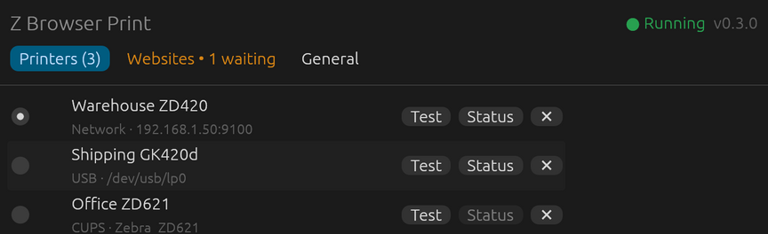
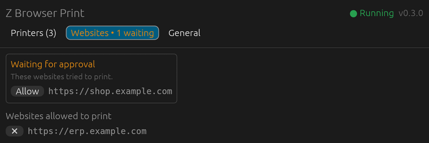

# Z Browser Print

A Linux alternative to Zebra Browser Print. It runs quietly in the tray and lets
web pages print raw ZPL to Zebra label printers. Web apps written for Zebra
Browser Print work unchanged.

<p align="center">
  
  
</p>

- **Works with Zebra's BrowserPrint JS library.** It answers on `http://127.0.0.1:9100`,
  just like Zebra's app does.
- **Asks first:** when a new website tries to print, a small window asks "Allow this website
  to print?". The page's print waits for your answer.
- **Printers:** network (TCP 9100), USB (`/dev/usb/lp*`) and CUPS queues (sent raw).
  **Find printers** looks for network printers for you.
- **Images and PDFs:** PNG, JPEG, GIF, BMP and PDF files are turned into ZPL graphics.
- **Tray icon:** switch the default printer, open the window, quit.
- **Settings window:** add, rename and remove printers, choose the default,
  print a test label, check printer status, approve websites, start at login.
- **Its own web API** on `http://127.0.0.1:9180`, with a small JS client (`zprint.js`).

## Install

Build the `.deb` package and install it:

```bash
./packaging/build-deb.sh
sudo apt install ./dist/z-browser-print_0.4.0_amd64.deb
```

Building needs Rust (https://rustup.rs). Printing PDFs needs `poppler-utils`, which the
package recommends.

The package installs:
- the command `zprint`, plus `zprint-fake-printer` for testing without hardware
- the app-menu entry **Accessories > Z Browser Print**
- a login entry, so the app starts in the tray for every user, like Zebra Browser Print
  (each user can turn this off in the window)

Click the tray icon to open the window. Closing the window keeps the app in the tray;
quit from the tray menu. To uninstall:

```bash
sudo apt remove z-browser-print
```

## Web apps made for Zebra Browser Print

Nothing changes in the web app. The first time it tries to print, a window asks
"Allow this website to print?". Click **Allow** and the print goes through.

- **Block** refuses the site for good. You can unblock it in the **Websites** tab.
- Closing the window without answering refuses it until Z Browser Print restarts. The site
  then waits in the **Websites** tab under "Waiting for approval", with an **Allow** button.
- To refuse new sites without asking, turn off "Ask when a new website wants to print" in
  the **General** tab.

| BrowserPrint call | Supported |
|---|---|
| `getDefaultDevice`, `getLocalDevices`, `getApplicationConfiguration` | yes |
| `device.send`, `sendFile` | yes |
| `read`, `sendThenRead`, `readUntilStringReceived`, `readOnInterval` | yes. Replies to query commands (`~HS`, `~HQES`, `^HH`, `! U1 getvar`...) are kept for the next `read` |
| `sendUrl` | yes. Z Browser Print downloads the file (http/https, up to 32 MB) |
| `convertAndSendFile`, `convert` | yes, to ZPL, for PNG, JPEG, GIF, BMP and PDF. Options: `toFormat: "zpl"`, `fitTo: {width, height}` in dots, `action: "print"` or `"return"` |
| `scanImage` | no. It returns an error saying so |

Images become one `^GFA` graphic per label: black where the picture is darker than
mid-grey, so logos and barcodes stay sharp. Each PDF page becomes one label at 203 dpi.
Images and PDFs sent with `send`, `sendFile` or `sendUrl` are converted too, rather than
reaching the printer as garbage.

`convert` with `action: "return"` gives `{"data": "<zpl>"}`. Zebra doesn't document this
response format, so this is our best match.

CUPS printers show up as Zebra "driver" printers. They print, but can't answer reads.

The BrowserPrint library only uses HTTPS (port 9101) on Safari, so on Linux plain
HTTP on 9100 is enough, even for HTTPS web apps. Recent Chrome versions may ask once
whether a site may access devices on your local network; click Allow.

If something else needs port 9100, turn off "Answer apps made for Zebra Browser Print"
in the General tab.

## Finding network printers

In **Printers > + Add printer > Network**, click **Find printers**. It checks every
address on your network (up to about 1,000) for port 9100 and lists what answers.
Zebra printers are named and shown in bold when they answer SNMP. Click **Use** to fill
in the address.

The scan never sends data to port 9100: it connects and hangs up. That's because any
other printer on port 9100 would print whatever it receives as text. To try the scan
from a terminal:

```bash
cargo run -p zprint-transports --example netscan
```

## Run from the source folder

```bash
cargo build --release
./target/release/zprint            # agent + tray icon
./target/release/zprint settings   # window (starts the agent if needed)
```

To test without a printer, start the fake printer:

```bash
python3 tools/fake_printer.py
```

Then add it as a network printer at `127.0.0.1`, port `9200`.

USB printers need write access to `/dev/usb/lp*`:

```bash
sudo usermod -aG lp $USER
```

Log out and in again after that.

## Its own web API

Allow your site in the Websites tab, then:

```html
<script src="http://127.0.0.1:9180/zprint.js"></script>
<script>
  const zp = new ZPrint();
  const printer = await zp.defaultPrinter();
  await zp.write(printer.id, "^XA^FO50,50^A0N,40,40^FDHello^FS^XZ");
  console.log(await zp.status(printer.id));
</script>
```

| Method | Path | Body | Returns |
|---|---|---|---|
| GET  | `/v1/version` | | `{name, version}` |
| GET  | `/v1/printers` | | list of `{id, name, connection, address}` |
| GET  | `/v1/printers/default` | | one printer |
| POST | `/v1/printers/{id}/write` | raw bytes | 204 |
| POST | `/v1/printers/{id}/read?timeout_ms=3000` | query, e.g. `~HQES` | reply text |
| GET  | `/v1/printers/{id}/status` | | parsed `~HS` |
| POST | `/v1/admin/reload` | | 204; re-reads the config (local programs only) |
| GET  | `/v1/admin/blocked` | | websites waiting for approval (local programs only) |

Errors are JSON `{ "error": "..." }`:

| Code | Meaning |
|---|---|
| 403 | origin or host not allowed |
| 404 | unknown printer |
| 501 | the printer can't answer (CUPS) |
| 502 | connection failed or bad reply |
| 504 | printer timed out |

## Config file

Settings live in `~/.config/zprint/config.toml`. The window edits this file for you.
Use `--config <path>` or `$ZPRINT_CONFIG` to point somewhere else.

```toml
port = 9180
zebra_compat = true       # answer Zebra's BrowserPrint library on 127.0.0.1:9100
allowed_origins = ["https://app.example.com"]
denied_origins = []        # sites you clicked Block for
ask_new_sites = true       # show the "Allow this website to print?" window
default_printer = "warehouse"

[[printers]]
id = "warehouse"
name = "Warehouse ZD420"
type = "network"          # network | usb | cups
host = "192.168.1.50"
port = 9100

[[printers]]
id = "desk"
name = "Desk GK420d"
type = "usb"
device = "/dev/usb/lp0"
serial = "28J123456789"   # optional; finds the printer again if it becomes lp1

[[printers]]
id = "shipping"
name = "Shipping (CUPS)"
type = "cups"
queue = "Zebra_ZD420"
```

## Security

- It listens on 127.0.0.1 only.
- `Host` must be 127.0.0.1, localhost or [::1] on one of its ports. This blocks DNS rebinding.
- A request with an `Origin` header must come from an allowed website, or you are asked
  first. Browsers send `Origin` on every cross-site request, so no website can print or
  list printers without your OK.
- `/v1/admin/*` refuses any request that has an `Origin` header (web pages).

## Layout

```
crates/core        config, Transport trait, ~HS parser
crates/transports  network, USB and CUPS transports; USB/CUPS discovery
crates/server      web API, BrowserPrint compatibility, origin/host guard, live reload
crates/settings    settings window (egui)
crates/agent       the zprint binary: agent, tray icon, command line
js/                zprint.js client and the test page
data/              icon, app-menu and login entries
packaging/         build-deb.sh
tools/             fake_printer.py
zebra/             where to put Zebra's BrowserPrint JS for reference (not included)
```

## Roadmap

- Dithering for photos (images are black/white at mid-grey today)
- `scanImage`
- HTTPS on port 9101 (only Safari uses it, which Linux doesn't have)

## License

MIT. Z Browser Print is not affiliated with Zebra Technologies. Zebra and Browser
Print are trademarks of Zebra Technologies.
